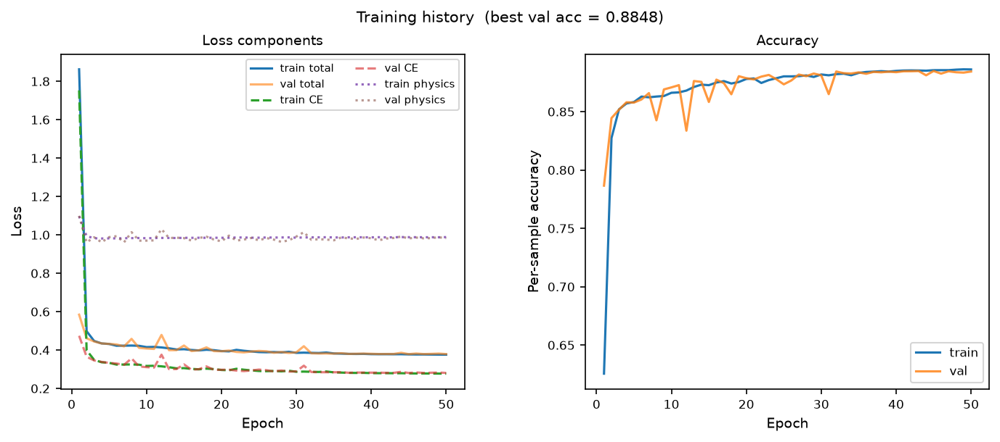
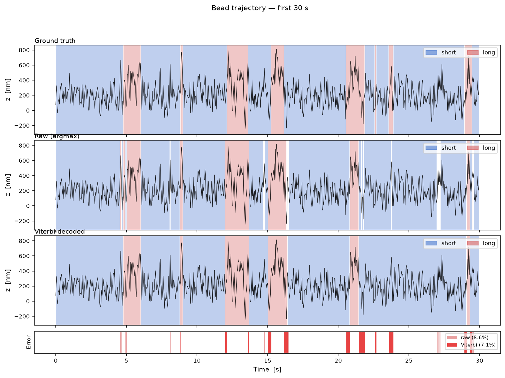
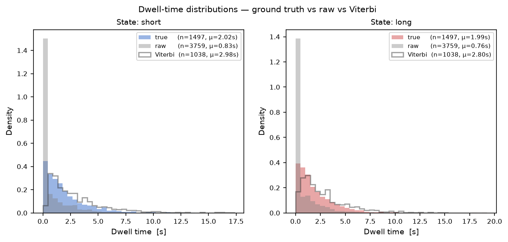
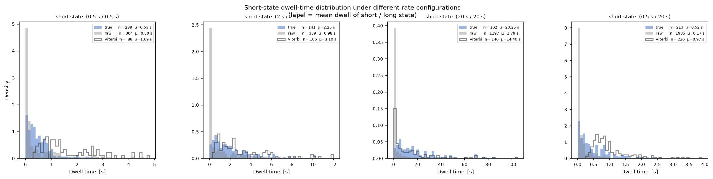
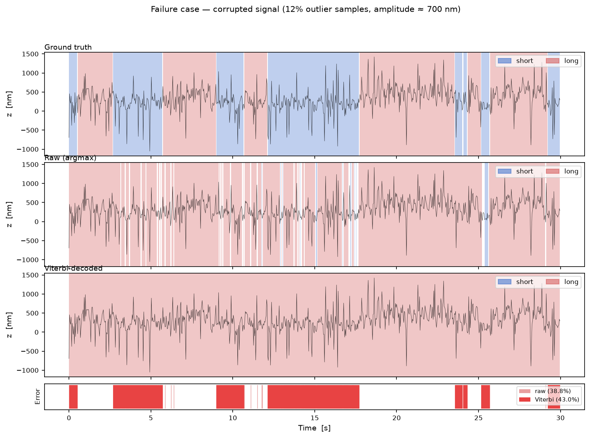
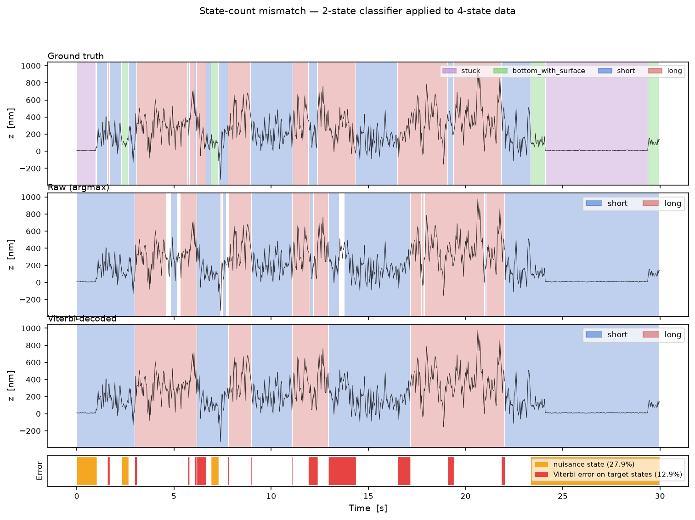
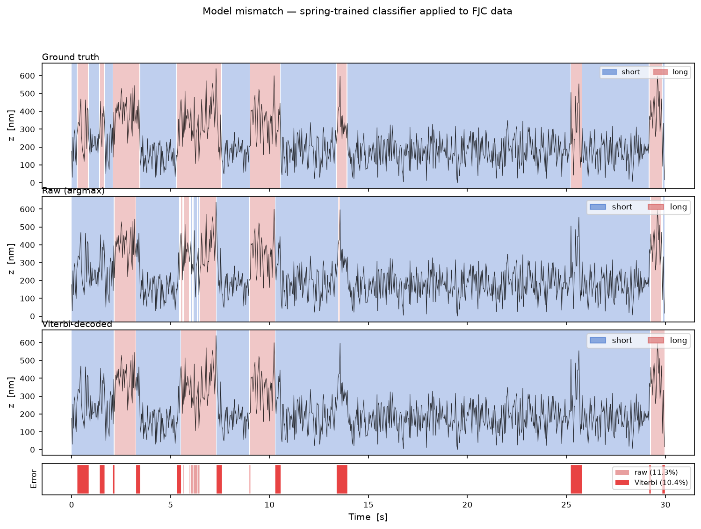

# Physics-Informed Neural Network for Segmentation and Classification of Stochastic Time Series

> *Showcase abstract — technical details available on request.*

## Overview

This project addresses a common problem in experimental science: a measured signal is a 1-D time series generated by a system that switches stochastically between discrete hidden states, and the goal is to **segment** the signal (locate state transitions) and **classify** each sample (assign a state label) from the raw trace alone, without access to a large hand-labelled corpus.

The core contribution is a **physics-informed neural network (PINN)** that combines supervised sequence labelling with an unsupervised regulariser derived from the known stochastic dynamics of the system.  A Viterbi post-processing step — which uses the physical transition-rate matrix as a prior — further improves temporal coherence.

## Simulated Data

Because the target application involves a system whose ground-truth state sequence is not directly observable in practice, all training and evaluation data are **simulated** from first principles.

The system is modelled as a 1-D particle driven by a stochastic differential equation:

$$
dz_t = F_s(z_t)\,dt + \sigma_s\,dW_t
$$

where $s$ is the current discrete state, $F_s(z_t)$ is the state-dependent deterministic restoring force (which drives the particle back to its equilibrium $z^{(s)}_{\mathrm{eq}}$), $\sigma_s$ is the diffusion amplitude, and $W_t$ is a standard Wiener process.  The switching between states follows a continuous-time Markov chain with user-specified transition rates.

The simulator draws long trajectories at a fixed sampling rate and records both the position trace and the ground-truth state sequence.  The ground truth is available only at training time, not at inference.

## Model

### Architecture

The backbone is a **1-D dilated residual CNN** that maps a raw position window of length $W$ to per-sample state logits:

```
Input  z ∈ ℝᵂ
  │
  ▼
┌─────────────────────────────────────────────────────────┐
│  Residual block 1  (dilation 1,  kernel 3, 32 ch)       │
│  Residual block 2  (dilation 2,  kernel 3, 32 ch)       │
│  Residual block 3  (dilation 4,  kernel 3, 32 ch)       │  receptive
│  Residual block 4  (dilation 8,  kernel 3, 32 ch)       │  field
│  Residual block 5  (dilation 16, kernel 3, 32 ch)       │  63 samples
│                         GroupNorm + GELU activations     │  ≈ 2.1 s
└─────────────────────────────────────────────────────────┘
  │
  ▼
Linear head  (1×1 conv):  32 ch → n_states logits
  │
  ▼
Output  logits ∈ ℝᵂˣⁿˢᵗᵃᵗᵉˢ   (per-sample, per-state)
```

Each residual block applies a dilated depthwise convolution followed by a pointwise convolution, with a skip connection and GroupNorm + GELU activations.  Non-causal (symmetric) padding preserves the input length at every block, so the output has the same length as the input with no boundary artefacts.

### Loss Function

Training minimises a combined loss:

$$
\mathcal{L} = \mathcal{L}_{\mathrm{CE}} + \lambda\,\mathcal{L}_{\mathrm{phys}}
$$

**Cross-entropy term** $\mathcal{L}_{\mathrm{CE}}$: standard per-sample cross-entropy against the ground-truth state labels.

**Physics regulariser** $\mathcal{L}_{\mathrm{phys}}$: assumes the restoring force can be linearised around the state equilibrium, so the discrete-time dynamics are approximately an Ornstein-Uhlenbeck (OU) process.  The OU innovation at timestep $t$ for state $s$ is

$$
\varepsilon_s[t] = z[t] - \alpha_s\bigl(z[t{-}1] - z^{(s)}_{\mathrm{eq}}\bigr) - z^{(s)}_{\mathrm{eq}},
$$

which should follow $\mathcal{N}(0,\,\sigma_{d,s}^2)$ when the system is in state $s$. The regulariser is the soft-weighted sum of squared normalised innovations:

$$
\mathcal{L}_{\mathrm{phys}} = \frac{1}{T}\sum_t \sum_s p_s[t]\left(\frac{\varepsilon_s[t]}{\sigma_{d,s}}\right)^{\!2},
$$

where $p_s[t] = \text{softmax}(\text{logits})[t, s]$.  This term penalises predictions that are inconsistent with the known stochastic dynamics and requires **no additional labels**.

### Post-Processing: Viterbi Decoder

After inference, the per-sample log-probabilities are passed to a **Viterbi decoder** that uses the physical transition-rate matrix as the HMM transition prior.  This enforces temporal coherence and substantially reduces spurious one- or two-sample state transitions that arise from window-boundary effects.

## Training

The model is trained with a cosine learning-rate schedule (AdamW optimiser, 50 epochs).  The figure below shows the evolution of the total loss and its two components on the training and validation sets, alongside the per-sample classification accuracy.



The CE loss dominates and decreases monotonically.  The physics loss (dotted) is on a different scale but provides a consistent regularisation signal throughout training.  Train and validation curves track closely, indicating no overfitting.

## Results

### Performance on Clean Data

Evaluated over **100 independent training and evaluation runs** (each with a freshly simulated 600 s test trace):

| Metric | Mean ± 95 % CI | [p5, p95] |
|---|---|---|
| Window accuracy | 88.79 ± 0.08 % | [88.12, 89.50] % |
| Trace accuracy — raw argmax | 88.77 ± 0.21 % | [86.89, 90.33] % |
| Trace accuracy — Viterbi | **89.49 ± 0.22 %** | [87.47, 91.16] % |
| Viterbi dwell — short state | 2.99 ± 0.07 s | [2.52, 3.58] s |
| Viterbi dwell — long state | 2.92 ± 0.08 s | [2.40, 3.55] s |

The figure below shows a representative 30-second segment.  Top: ground-truth state sequence.  Middle: raw per-sample argmax.  Bottom: Viterbi-decoded sequence.  The error strip highlights misclassified samples.



Viterbi decoding removes most isolated mis-classified samples visible in the raw argmax, at the cost of slightly over-extended state boundaries.

The dwell-time distributions below contrast the ground-truth dwell times with those inferred from the raw argmax (heavily over-segmented — many spurious short dwells) and from the Viterbi decoder (much closer to the ground truth).



### Sensitivity to Mean Dwell Time

The Viterbi decoder uses the training transition rates as a fixed prior ($k_{12} = k_{21} = 0.5$ /s, mean dwell ≈ 2 s).  The figure below shows the short-state dwell-time distribution under four rate configurations, ranging from sub-second switching to 20-second average dwells.



Key observations:

- **Matching training (2 s / 2 s)**: Viterbi faithfully recovers the true distribution — both the mean and the count of detected dwells agree closely.
- **Fast switching (0.5 s / 0.5 s)**: Viterbi over-smooths heavily.  The estimated mean dwell is ≈ 3× the true value, and only ≈ 30 % of true transitions are detected.  The HMM prior, calibrated for ≈ 2 s dwells, suppresses rapid switching.
- **Slow switching (20 s / 20 s)**: Slight over-segmentation — Viterbi splits some long dwells, producing a slightly shorter estimated mean dwell.
- **Asymmetric (0.5 s / 20 s)**: Short-state dwells are over-estimated by ≈ 2×; the long state is largely unaffected.

This reveals a general limitation: the Viterbi step introduces a **systematic bias** whenever the operational transition rates differ significantly from the training rates.  A natural remedy is to re-calibrate the prior after a first-pass inference, or to treat the transition rates as learnable parameters.

### Failure Case: Outlier-Corrupted Signal

When the input signal is severely corrupted — here, 12 % of samples are replaced by outlier spikes of amplitude ≈ 700 nm (≈ 5× the typical RMS fluctuation) — the classifier is significantly degraded.



The raw argmax error rate rises to **≈ 39 %** and the Viterbi decoder, which regularises temporal coherence rather than amplitude outliers, cannot recover (**≈ 43 %** error rate).  This motivates future work on robustness — training with a simulated acquisition model that includes outlier artefacts could allow the classifier to suppress them.

### Generalisation Mismatch I: More States than Trained For

A 2-state classifier is applied directly to a trace generated by a **4-state** system that includes two additional nuisance states at lower equilibrium positions (at ≈ 10 nm and ≈ 100 nm, versus the trained targets at ≈ 200 nm and ≈ 400 nm).



The top panel shows the full 4-state ground truth (purple = stuck near surface, green = intermediate state, blue = short, pink = long).  The classifier can only output two states (blue / pink); it has no concept of the nuisance states.

The error strip distinguishes two types of failure:

- **Orange (27.9 %)** — samples in nuisance states.  The classifier is applied completely outside its training domain; it assigns arbitrary labels.
- **Red (12.9 %)** — samples in the target states (short / long) that are misclassified.  Even within its domain, performance degrades vs. the clean case (≈ 11 % baseline) because the nuisance states create unusual transition patterns and shift the apparent equilibrium statistics.

This case illustrates a fundamental limitation of fixed-class classifiers applied to open-world signals: there is no mechanism to detect or abstain on out-of-distribution segments.

### Generalisation Mismatch II: Wrong Force-Extension Model

The physics regulariser is derived assuming a **linearised (harmonic) restoring force** — the simplest approximation of a nonlinear elastic tether.  Here, the same 2-state classifier (trained on the harmonic model) is applied to a trace generated with a **nonlinear (FJC) force-extension law**, with contour lengths chosen so that the equilibrium positions remain close to the training values (≈ 183 nm and ≈ 367 nm vs. the trained 200 nm and 400 nm).



Surprisingly, classification accuracy is essentially unchanged (raw error ≈ 11 %, Viterbi error ≈ 10 % — matching the clean baseline).  The classifier generalises because:

- The equilibrium positions of the two states remain well separated and close to the training values, so the CE term still drives a correct decision boundary based on mean position.
- The FJC fluctuation amplitude is smaller (≈ 79 nm and 111 nm vs. the trained 132 nm and 209 nm), making the states *easier* to separate, not harder.

However, the physics regulariser is technically **inconsistent**: it penalises predictions using OU innovations computed from the harmonic parameters, whereas the FJC dynamics violate those statistics.  The invisible degradation is in the physics term itself — the trained model learns to partially ignore it when it conflicts with the CE gradient.  This highlights that the regulariser's benefit is most pronounced when the training and test distributions share the same stochastic model, and motivates learning or adapting the physics parameters at inference time.

## Summary

| Component | Description |
|---|---|
| Signal | 1-D SDE with state-dependent restoring force and Markov switching |
| Architecture | 5-block dilated residual CNN, receptive field ≈ 2.1 s |
| Loss | Cross-entropy + physics regulariser (linearised OU innovation) |
| Post-processing | Viterbi decoder with physical transition-rate prior |
| Clean performance | ≈ 89.5 % trace-level accuracy (100-run mean ± 95 % CI) |
| Robustness | Graceful degradation under mild noise; fails under heavy outliers |
| Dwell-time bias | Systematic Viterbi over/under-smoothing when rates differ from training |
| Out-of-distribution | Degrades when extra states are present; robust to force-law mismatch when equilibria match |

*For access to the full source code, training pipeline, and ablation study, please contact the author.*
